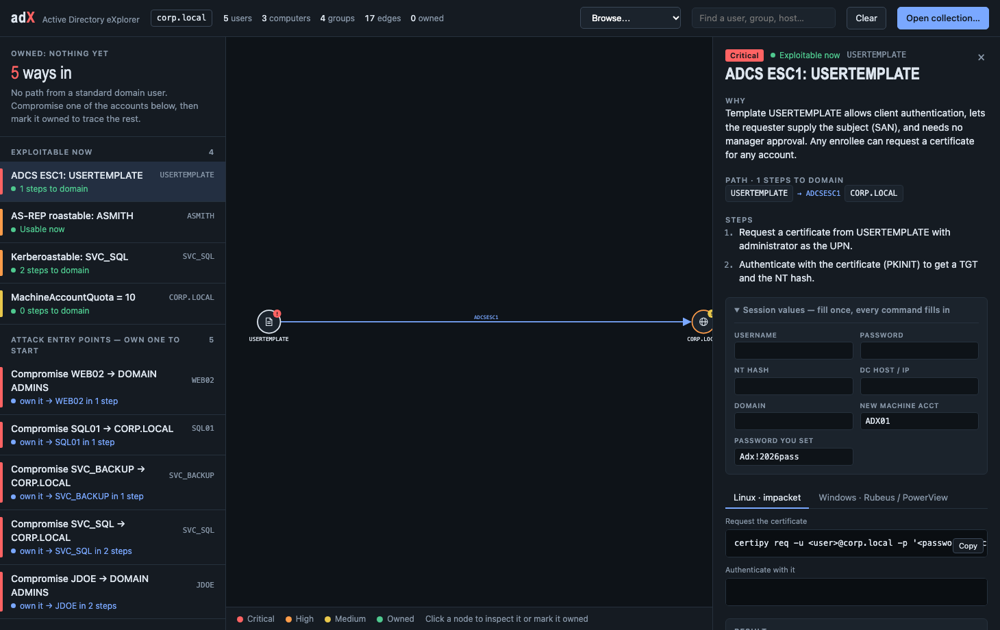

# adX — Active Directory eXplorer

**BloodHound sniffs. adX sees.**

adX collects an Active Directory domain and tells you, straight away, **where the
attack paths are** — no Neo4j, no Postgres, no Docker. One static binary, in
memory, open in your browser in seconds. It is built for the moment in an
engagement (or an exam) when you have a foothold and need the next move, not a
graph to go spelunking in.



## Two tools

- **`adx`** — the analysis GUI. Opens a collection and surfaces the attack paths.
- **`adx-collector`** — a SharpHound-compatible collector. Gathers the domain
  over LDAP from your attack host (or a domain-joined box) and writes a zip the
  GUI opens.

Both are single static binaries for macOS, Linux and Windows (amd64 / arm64,
plus Windows x86). No install, no dependencies.

## Quick start

Collect, then view:

```sh
# 1) collect (remote, with a password)
./adx-collector -dc 10.10.10.10 -d corp.local -u jdoe -p 'Winter2026!'

# 2) open the GUI and drag the resulting *_adx.zip into the window
./adx
```

Run `./adx` with no collection to explore a built-in sample domain first. It
reads SharpHound / bloodhound-python `.zip`, `.7z`, `.tar.gz` and `.json` too, so
you can point it at existing loot.

## What the GUI gives you

- **Findings, ranked for you.** Kerberoast, AS-REP, unconstrained / constrained
  delegation, RBCD, DCSync, ADCS ESC1, LAPS / gMSA reads, shadow credentials and
  dangerous ACLs over tier-zero — grouped into *exploitable now*, *attack entry
  points*, *reachable with extra steps*, and *not reachable yet*.
- **Where do I start?** With nothing owned it lists the accounts whose
  compromise opens a path to Domain Admins, nearest first.
- **Mark as owned.** Click a node, mark it owned, and every path re-ranks from
  there; the shortest route to the domain updates as you go.
- **Attack cards with runnable commands.** Each finding explains why it works,
  the path from your owned principals, the steps, and copy-paste commands for
  Linux (impacket, certipy, bloodyAD) and Windows (Rubeus, PowerView, Certipy,
  Whisker). Fill the session values (user, password, hash, DC, machine account)
  once and every command fills in.
- **Local by default.** The app closes itself when you close the browser tab;
  `adx serve` runs a shared, read-only instance for a team.

## What the collector gathers

Over a single LDAP(S) connection, leaving nothing on the target:

- Users, groups, computers, OUs, GPOs, containers, domains + group membership
- UAC flags: delegation, AS-REP roastable, SPN / kerberoastable, DC
- ACLs: GenericAll, GenericWrite, WriteDacl, WriteOwner, Owns, AllExtendedRights,
  ForceChangePassword, AddMember, AddKeyCredentialLink, GetChanges(+All) → DCSync
- RBCD (`msDS-AllowedToActOnBehalfOfOtherIdentity`)
- ADCS certificate templates and enterprise CAs (ESC1)
- LAPS / gMSA password-read rights (schema GUIDs resolved at runtime)

Authentication:

```sh
adx-collector -dc dc01.corp.local -d corp.local -u jdoe -p 'pw'            # password
adx-collector -dc dc01.corp.local -d corp.local -u jdoe -H <nthash>        # pass-the-hash
export KRB5CCNAME=/tmp/jdoe.ccache
adx-collector -dc dc01.corp.local -d corp.local                            # ticket (local)
adx-collector -dc dc01.corp.local -d corp.local -u jdoe -p 'pw' -ldaps -k  # LDAPS
```

## Build from source

```sh
go build -o adx .                 # the GUI, your platform
go build -o adx-collector ./cmd/adx-collector
./scripts/build.sh 0.1.0          # both, all platforms, into dist/
./scripts/macapp.sh arm64         # a double-clickable adX.app (macOS)
```

## Roadmap

1. Sessions & local admin via SMB/RPC (`HasSession`, `AdminTo`).
2. More ADCS (ESC2–ESC8), constrained-delegation and GPO edges.
3. Local LLM analysis (Ollama) — the model drives the same queries as tools, so
   AD data never leaves the host.

## Status

Early, but validated end-to-end against live domains. The detection rules are
still maturing — read the attack card and understand the path before you run a
command, rather than trusting it blindly.

## Legal

For authorized security testing and education only (engagements with written
permission, labs, CTFs). You are responsible for how you use it.
